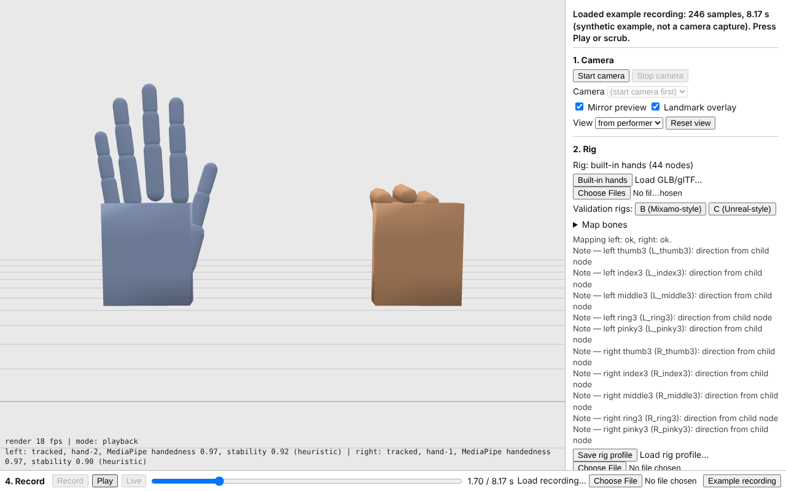
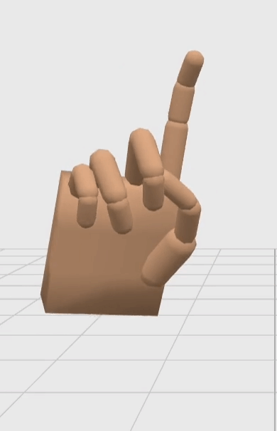
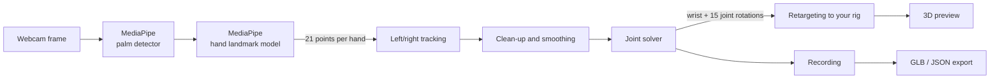
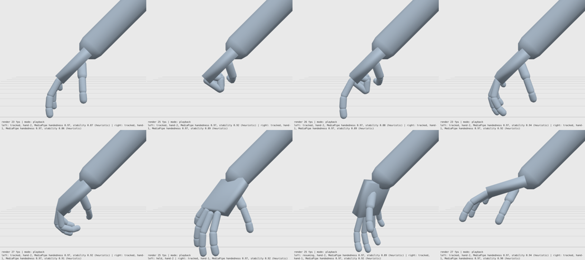

# HandMocap

**Hand motion capture with an ordinary webcam, in your browser. Animate any hand rig and export it as a standard GLB animation.**

[](LICENSE)




HandMocap watches your hands through a webcam, works out how every finger joint and the wrist are rotating, and puts that motion onto a 3D character's hands. You can record a take and export it as a `.glb` animation that opens in Blender, Godot, Unity, Unreal and three.js.

No gloves, no special camera, no account, no installation. Video is processed on your own computer and is never uploaded.




---

## Contents

- [Who it is for](#who-it-is-for)
- [Quick start](#quick-start)
- [How it works](#how-it-works)
  - [1. MediaPipe finds the hand](#1-mediapipe-finds-the-hand)
  - [2. HandMocap turns points into motion](#2-handmocap-turns-points-into-motion)
- [What is new here](#what-is-new-here)
- [Using your own character](#using-your-own-character)
- [Exports](#exports)
- [Limitations](#limitations)
- [Privacy](#privacy)
- [For developers](#for-developers)
- [License and credits](#license-and-credits)

---

## Who it is for

Indie animators, game developers and students who need believable hand and finger animation but don't have a mocap studio or a data glove. Typical uses:

- Gestures and finger acting for a character in a game cutscene
- Hands on a steering wheel, keyboard or controller
- Blocking out hand animation quickly before polishing it by hand
- Learning how motion capture and retargeting work

## Quick start

**Windows:** download this repository (**Code → Download ZIP**), unzip it, and double-click **`Start HandMocap.bat`**. Your browser opens HandMocap. Keep the small black window open while you use it.

**Mac / Linux:** download and unzip, open a terminal in the folder and run:

```sh
python3 -m http.server 8080
```

Then open <http://localhost:8080>.

> Opening `index.html` by double-clicking it does **not** work. Browsers only allow the camera on pages served from `localhost` or `https://`.

Then, in the app:

1. **Start camera** and click **Allow** when the browser asks.
2. **Calibrate.** Hold both hands open, palms to the camera, fingers up, about 50 cm away, for two seconds.
3. Move your hands. The 3D hands follow.
4. **Record**, then **Stop**. Use **Play** and the timeline to review.
5. **Export → Rig animation (.glb)**.

No webcam? Press **Example recording** to try playback and export.

## How it works

HandMocap has two halves. Google's free **MediaPipe** model finds the hands in each video frame. HandMocap's own code turns what MediaPipe sees into animation.



### 1. MediaPipe finds the hand

[MediaPipe Hand Landmarker](https://ai.google.dev/edge/mediapipe/solutions/vision/hand_landmarker) is a pair of small neural networks from Google that run inside the browser:

1. **Palm detector.** Looks at the whole frame and finds where palms are. Palms are easier to spot than whole hands because they are rigid and roughly square.
2. **Landmark model.** Crops around each palm and predicts **21 landmarks**: the wrist plus four points along each finger (knuckle to fingertip). For every landmark it returns:
   - an **image position** (where it is in the picture), and
   - a **3D position in metres** relative to the centre of the hand ("world landmarks").

   It also guesses whether the hand is a **left or right** hand, with a confidence score.

After the first detection, the model tracks the hand from frame to frame instead of searching the whole image again, which keeps it fast.

```
        8   12  16  20        fingertips
        |   |   |   |
        7   11  15  19
        |   |   |   |
   4    6   10  14  18
   |    |   |   |   |
   3    5---9---13--17        knuckles
    \   |           /
     2  |          /
      \ |         /
       1|        /
        0--------             wrist
```

What MediaPipe gives you is **points**, not animation. A character rig needs **rotations** on its bones, in the right order and in the rig's own axis conventions. Turning one into the other is the job of HandMocap.

### 2. HandMocap turns points into motion

Each step runs once per camera frame:

| Step | What it does | Why it matters |
|---|---|---|
| **Left/right tracking** | Gives each hand a stable identity using its position on screen, the model's left/right guess, and the shape of the curled fingers. | MediaPipe's left/right label sometimes flickers. Without this, hands swap mid-take. |
| **Clean-up** | Rejects broken frames (impossible finger lengths, sudden 100° wrist flips) and smooths jitter with a speed-aware filter. | Fast moves stay responsive; slow, still poses stay steady. |
| **Joint solver** | Builds a frame for the palm from the wrist and knuckles, then measures each finger's bend and spread relative to it. The thumb gets its own model because it moves differently. | Produces actual joint rotations: a wrist orientation plus 15 finger and thumb joints. |
| **Calibration** | You hold a neutral open hand for two seconds. The average of many frames becomes your "rest pose". | Everyone's relaxed hand is slightly curled. Calibration makes *your* neutral equal the rig's neutral. |
| **Tracking loss** | If a hand disappears, its last pose is held briefly, then blends to a relaxed pose; it blends back in when it returns. | No snapping or exploding fingers when tracking drops. |
| **Retargeting** | Works out, from the rig's own rest pose, which way each bone bends, then applies the solved rotations in that bone's own axes. | The same motion works on rigs with different bone names, axes, sizes and rest poses. |
| **Recording and export** | Stores the motion with its real timestamps, resamples it to 24/25/30/60 fps and bakes it into the rig. | Exported files play anywhere, with no HandMocap code needed. |

## What is new here

MediaPipe is free, and demos that draw dots on your hands are common. Tools that turn those dots into **animation you can use on your own character** are rare, and most of them are paid or tied to one app. HandMocap aims at that gap:

- **Any hand rig, not just the built-in one.** Load your own GLB/glTF character, map its bones (automatic suggestions for Mixamo, Unreal, Blender/Rigify, VRM and 3ds Max naming), calibrate, and drive it with the same pipeline.
- **A real animation file out.** Exports a standard glTF 2.0 skeletal animation. After every export, HandMocap re-imports the file and checks every bone matches what you saw.
- **Runs entirely in a browser on your machine.** No upload, no account, no plugin, no game engine required.
- **Honest about what one camera can see.** It reports when a finger is guessed rather than measured, and never claims studio accuracy.



## Using your own character

1. **Load GLB/glTF…** and pick your file.
2. Open **Map bones**. HandMocap suggests a mapping from the bone names; correct any row with the drop-downs, then **Apply mapping**.
3. Read the report under the panel. It warns about things like missing finger segments or control bones that don't deform the mesh.
4. **Calibrate**, then record as usual.
5. **Save rig profile** stores your mapping and calibration so you don't have to repeat it.

Your rig needs a wrist bone and at least the index and pinky (or ring) knuckle bones on each hand. Missing finger segments are allowed.

Two test rigs are included under `examples/` (**Validation rigs B / C** buttons): a Mixamo-style T-pose rig and an Unreal-style A-pose rig with mirrored bone axes.

## Exports

| Button | File | Use it for |
|---|---|---|
| **Rig animation (.glb)** | Your rig plus a baked animation clip (glTF 2.0) | Blender, Godot, Unity, Unreal, three.js |
| **Canonical motion (.json)** | HandMocap's own format: wrist + joint rotations over time | Re-loading into HandMocap, or your own tools |
| **Raw landmarks (.json)** | MediaPipe's 21 points per frame (enable *Record raw landmarks* first) | Debugging and research |

Full file formats and coordinate conventions: [docs/reference.md](docs/reference.md#recording-and-export).

## Limitations

A single webcam sees the world flat. Plan for some cleanup:

- **Hidden fingers** (behind the palm or the other hand) are guessed by the model and can be wrong.
- **Hand position in space** is not measured. By default the wrist rotates in place; an *approximate* position mode exists but depth is an estimate.
- **Finger twist** cannot be seen and is held at zero.
- **Fast motion, low light and overlapping hands** cause dropouts. These are held and blended rather than snapped.
- It was tested with real MediaPipe output on photos and with synthetic data, but **not yet in long live sessions**. See the [validation report](docs/validation-report.md).

## Privacy

- Camera frames are processed on your device and never uploaded by HandMocap.
- Imported rigs, recordings and exports stay on your computer.
- HandMocap downloads three.js and the MediaPipe model from public CDNs the first time you start the camera. To avoid this, run `node tools/vendor.mjs` to keep a local copy.
- Google's MediaPipe privacy notice states that MediaPipe may send anonymous performance and usage statistics to Google. If you distribute HandMocap, read [Privacy in the reference](docs/reference.md#privacy).

## For developers

Plain JavaScript modules, no build step. Requires a browser with WebGL 2.

```sh
npm install      # only for the tests
npm test         # 28 tests: solver math, retargeting, calibration, export round trips
```

| Folder | Contents |
|---|---|
| `src/` | The app: tracking, solver, retargeting, recording, export, UI |
| `examples/` | Two test rigs, an example profile, a synthetic example recording |
| `tests/` | Node tests and a headless-browser test script |
| `tools/` | Test-rig generators, self-hosting script, Windows launcher server |
| `docs/` | [Full reference](docs/reference.md) and [validation report](docs/validation-report.md) |

Pinned dependencies: three.js 0.186.1, MediaPipe Tasks Vision 1.0.1, hand landmarker model float16/1.

## License and credits

Released under the [Apache License 2.0](LICENSE).

Built on [MediaPipe](https://github.com/google-ai-edge/mediapipe) (Apache 2.0) by Google and [three.js](https://threejs.org) (MIT). HandMocap is an independent project, not affiliated with or endorsed by Google.

Mashed together (Created) by Kostis Spyroglou, made sense of (Developed) with Claude Code.
